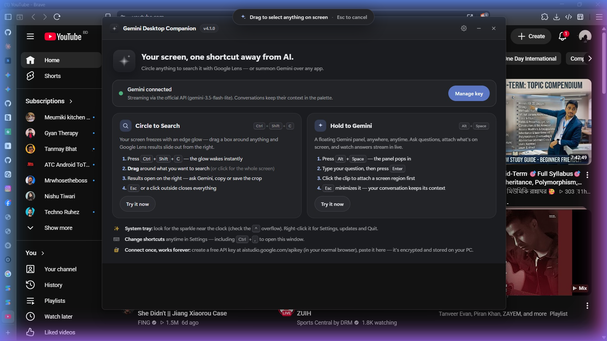
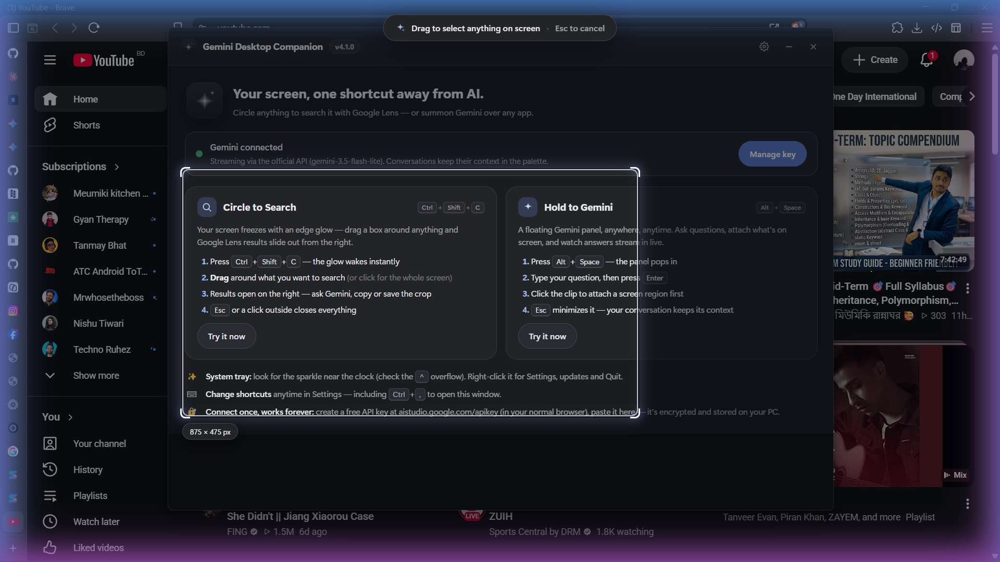
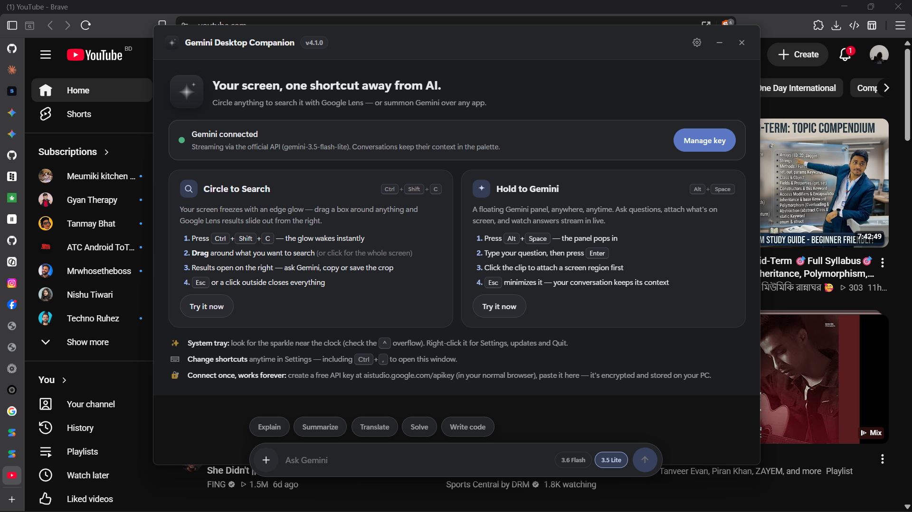
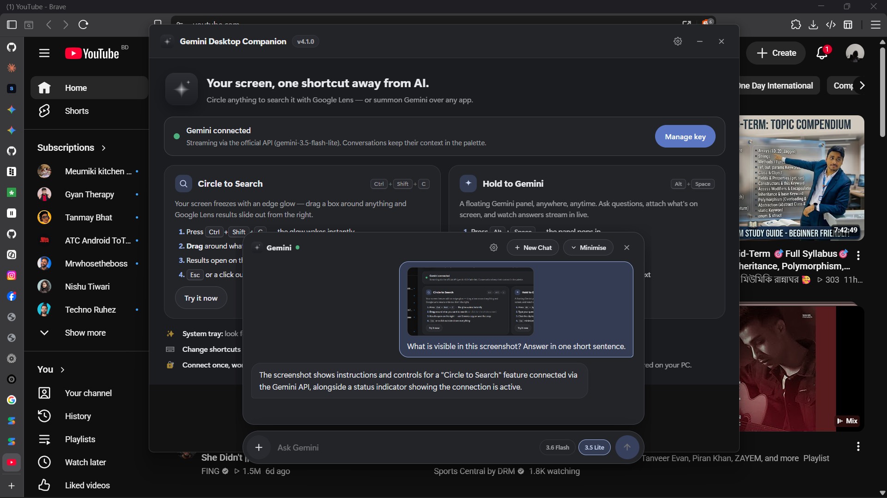
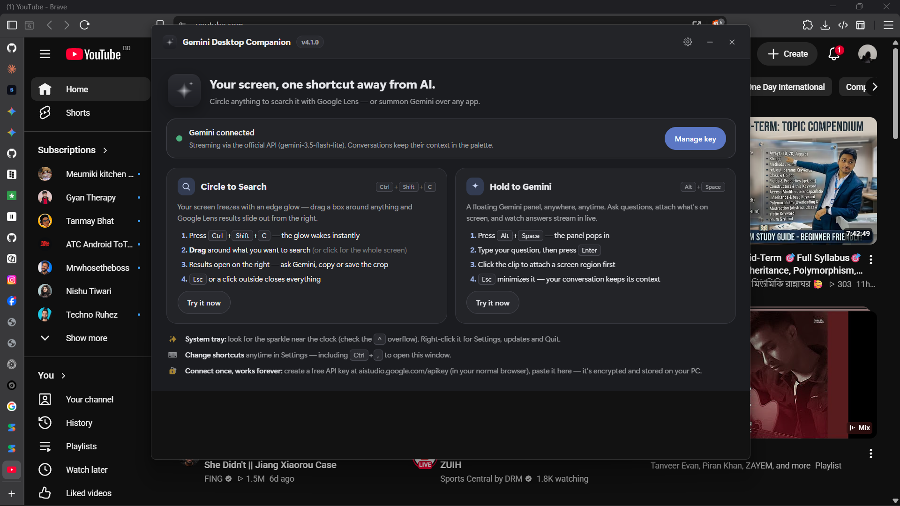
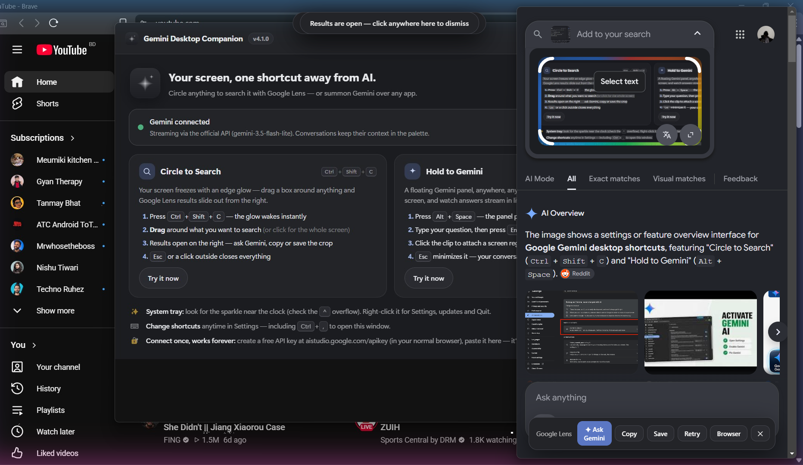
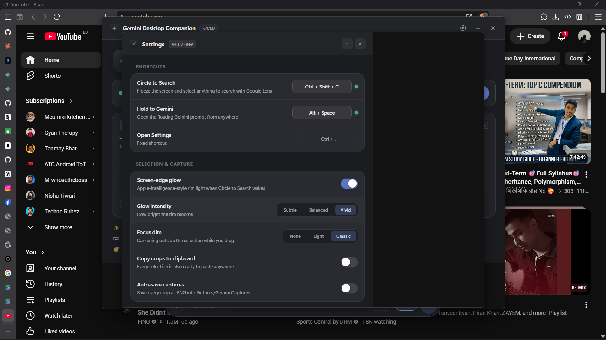
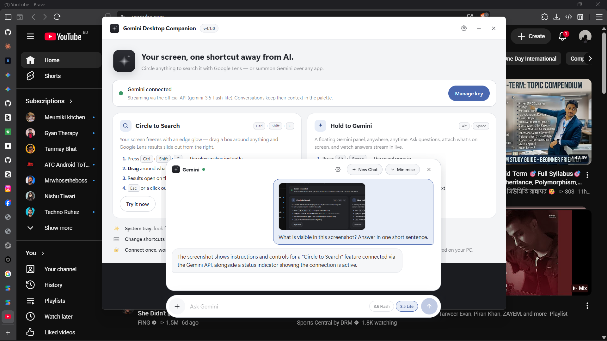

<div align="center">

# ✨ Gemini Desktop Companion

**Circle to Search + Hold to Gemini for Windows — Android's AI screen search, on your PC.**

Select anything on your screen and search it with **Google Lens**, or summon a floating **Google Gemini** pill over any app. Instant wake, pixel-clean captures, and an Apple-Intelligence-style edge glow.

[](https://github.com/Shishir-ip/Gemini-Desktop-Companion/releases/latest)
[](https://github.com/Shishir-ip/Gemini-Desktop-Companion/releases)
[](#-getting-started)
[](#-build-from-source)
[](LICENSE)
[](https://github.com/Shishir-ip/Gemini-Desktop-Companion)

<br/>

[](https://github.com/Shishir-ip/Gemini-Desktop-Companion/releases/latest/download/Gemini-Desktop-Companion-Setup.exe)

**[⬇ Download the installer](https://github.com/Shishir-ip/Gemini-Desktop-Companion/releases/latest/download/Gemini-Desktop-Companion-Setup.exe)** · [All releases](https://github.com/Shishir-ip/Gemini-Desktop-Companion/releases) · [Report a bug](https://github.com/Shishir-ip/Gemini-Desktop-Companion/issues)

<sub>Windows 10/11 (64-bit) · ~78 MB · No account needed to install · Free Gemini API key connects in 30 seconds</sub>

<br/>



</div>

---

## 🤔 What is Gemini Desktop Companion?

Gemini Desktop Companion brings two of Android's most-loved AI features to your Windows desktop:

- **🎯 Circle to Search for PC** — press a hotkey, your screen freezes with a glowing edge, drag a box around *anything* (text, an image, a product, an error message) and get **Google Lens** results in a slide-out panel.
- **💬 Hold to Gemini** — an Android-style floating **Gemini pill** appears at the bottom of your screen. Ask questions, attach what's on screen, and watch answers stream in live — powered by the **official Google Gemini API**.

If you've searched for *"Circle to Search on Windows"*, *"Gemini desktop app"*, *"Google Lens for PC"*, *"AI screen search"*, or *"select part of screen and search"* — this is exactly that, in one lightweight tray app.

<div align="center">

| Circle to Search | Gemini pill | Gemini chat |
| :---: | :---: | :---: |
|  |  |  |

</div>

---

## 🌟 Features

| Area | What you get |
| --- | --- |
| **🎯 Circle to Search** | One hotkey freezes every monitor with an **Apple-Intelligence-style rim glow**. Drag a glowing rectangle (pixel-exact, HiDPI-aware) — Google Lens results slide in from the right. |
| **⚡ Instant wake (~200ms)** | Pre-warmed windows + a fast GDI capture path. No 4–5 second waits, no black overlay, no duplicate overlays. |
| **🧼 Pixel-clean captures** | Crops are cut **in the main process from the lossless original** — the delivered image never contains the overlay, glow, or dim. |
| **💬 Gemini pill** | Android-style bottom capsule: **＋ capture · prompt · model chips · send**. Expands into a scrollable chat sheet with **New Chat** and **Minimise** capsules. |
| **🛠 Lens action toolbar** | **Ask Gemini** (hands the crop to the chat), **Copy**, **Save**, **Retry**, **Open in browser**, **Close**. |
| **🧠 Quick actions** | Explain · Summarize · Translate · Solve · Write code — appear on an empty chat and right after attaching a capture. |
| **⏹ Stop / 📋 Copy** | Cancel mid-stream and keep the partial answer · copy buttons on every answer and code block. |
| **🔀 Model switcher** | Toggle **gemini-3.6-flash** / **gemini-3.5-flash-lite** right inside the pill. |
| **🎨 Two professional themes** | Greyish **graphite dark** and **soft white** light. Solid, bold surfaces — no transparency, no rainbow gradients. |
| **✨ Capture options** | Glow on/off + intensity (Subtle/Balanced/Vivid), focus dim (None/Light/Classic), copy crops to clipboard, auto-save PNGs to Pictures. |
| **🖥 Tray daemon** | Lives quietly in the system tray. Left-click = Home, right-click = Settings / Updates / Quit. Optional launch at Windows startup. |
| **⌨️ Custom hotkeys** | Re-record both shortcuts in Settings with conflict detection. |

### More screenshots

<div align="center">

| Home | Lens results | Settings | Light theme |
| :---: | :---: | :---: | :---: |
|  |  |  |  |

</div>

---

## 🆕 What's new in v4.1.0

A ground-up redesign + reliability overhaul compared to v3.6.x:

| | Old app (v3.6.x) | v4.1.0 |
| --- | --- | --- |
| **Wake time** | 4–5 seconds, black overlay while waiting | **~200ms**, glow appears over the frozen screen |
| **Captures** | Crop could include the dim/overlay; repeated triggers compounded darkness | **Lossless main-process crops** — always clean; capture happens before any UI is shown |
| **Overlays** | Could stack / linger after re-triggers | Strict single-session guard, monitor hot-plug handling, guaranteed Esc kill-switch |
| **Look** | Colorful glassmorphism, transparent panels | **Solid professional UI**: graphite dark + soft white, one restrained accent, premium monochrome logo |
| **Gemini UI** | Fixed-size centered window | **Android-style bottom pill** that grows into a scrollable chat; New Chat / Minimise capsules; quick actions; send button in the pill |
| **Lens panel** | Plain results | Floating toolbar: **Ask Gemini · Copy · Save · Retry · Browser · Close** |
| **API key panel** | Kept showing after connecting | Hides once connected; manage/change/remove the key in **Settings** only |
| **Rendering** | Software compositing (black-window bug on Windows) | GPU compositing — reliable transparent overlays |
| **Capture engine** | `desktopCapturer` only (slow on many PCs) | Persistent **GDI runspace** fast path + automatic `desktopCapturer` fallback |

Full history: [CHANGELOG.md](CHANGELOG.md) · [Releases](https://github.com/Shishir-ip/Gemini-Desktop-Companion/releases)

---

## 🚀 Getting Started

### Install (30 seconds)

1. **[⬇ Download `Gemini-Desktop-Companion-Setup.exe`](https://github.com/Shishir-ip/Gemini-Desktop-Companion/releases/latest/download/Gemini-Desktop-Companion-Setup.exe)** (always the latest version).
2. Run the installer — per-user, no admin needed. Desktop + Start Menu shortcuts included.
3. Launch. The **Home window** explains everything. Look for the ✨ sparkle in your system tray.

> **Windows SmartScreen note:** the installer is unsigned (open-source project). Click **More info → Run anyway**. You can always [build from source](#-build-from-source) instead.

### Connect Gemini (free)

1. Open **Settings → Gemini API** (or the banner in the pill) and click **Get API key** — your browser opens [aistudio.google.com/apikey](https://aistudio.google.com/apikey).
2. Sign in with Google, click **Create API key** (free tier included).
3. Paste the key (starts with `AIza`) into the app and hit **Connect**.

The key is **encrypted on your PC** (Windows DPAPI). Once connected, the panel hides — change or remove the key anytime in Settings. Google Lens works with your normal Google session; no key needed for Lens.

### ⌨️ Default shortcuts

| Action | Default | Customizable |
| --- | --- | --- |
| Circle to Search | <kbd>Ctrl</kbd> + <kbd>Shift</kbd> + <kbd>C</kbd> | ✅ Settings → Shortcuts |
| Hold to Gemini | <kbd>Alt</kbd> + <kbd>Space</kbd> | ✅ Settings → Shortcuts |
| Open Settings | <kbd>Ctrl</kbd> + <kbd>,</kbd> | ❌ fixed |
| Dismiss | <kbd>Esc</kbd> / click outside | — |

**Gestures:** *drag* selects a region · a plain *click* searches/attaches the **whole screen** · while Lens results are open, clicking the frozen screen dismisses everything. The pill's **＋** uses the same selection tool for attachments.

---

## ❓ FAQ

<details>
<summary><b>Is this the same as Android's Circle to Search?</b></summary>

It's a faithful desktop recreation: hotkey → frozen screen → drag to select → Google Lens results. It works on any Windows 10/11 PC, across all monitors, with any app on screen.
</details>

<details>
<summary><b>Does it work without a Gemini API key?</b></summary>

Yes — **Circle to Search / Google Lens works without any key**. The key is only needed for the Hold to Gemini chat (free tier from Google AI Studio).
</details>

<details>
<summary><b>Why is my capture clean when other screenshot tools capture the overlay?</b></summary>

The screen is captured *before* any overlay window is shown, and crops are cut from the lossless original in the main process — the glow, dim and selection UI can never leak into the image.
</details>

<details>
<summary><b>A hotkey doesn't fire</b></summary>

Another app may own that combination. Settings → Shortcuts shows a red dot for unregistered hotkeys — re-record it with something else.
</details>

<details>
<summary><b>Gemini responses are slow or rate-limited (429)</b></summary>

The free tier has per-minute and daily quotas. The app auto-retries with backoff. For heavy use, a paid-tier API key works with the same paste-a-key flow.
</details>

<details>
<summary><b>The screen feels frozen / an overlay is stuck</b></summary>

<kbd>Esc</kbd> always dismisses everything — enforced in the main process even if a page fails to render.
</details>

<details>
<summary><b>Is it safe? Where do my screenshots go?</b></summary>

No telemetry, no backend. Screenshots go only to Google (Lens / Gemini API) unless you enable local clipboard/auto-save. The API key is encrypted with Windows DPAPI. See [Privacy](#-privacy).
</details>

---

## 🧠 How It Works

**Circle to Search**
1. Hotkey → the screen is captured via a persistent **GDI runspace** (~150–250ms) *before* any window appears — clean by construction. Pre-warmed overlays show the frozen frame with the animated rim glow. (`desktopCapturer` is the automatic fallback.)
2. You drag a rectangle; the renderer sends only the **selection rect** to the main process.
3. Main crops the **lossless original** at physical-pixel resolution and uploads it to Google Lens via a browser-native multipart POST on your Google session.
4. Results render in the slide-out panel with the floating action toolbar.

**Hold to Gemini**
1. Hotkey → the pre-warmed pill pops up from the bottom and grows upward into a chat sheet as the conversation continues.
2. Prompts call the **official Gemini API** with SSE streaming (`streamGenerateContent`); screenshots attach natively as `inline_data`.
3. Markdown answers stream token-by-token with code copy and per-answer copy; multi-turn context is preserved.

```text
src/
├── main/            # Electron main: capture engine, windows, IPC, Gemini API client
│   ├── gdiCapture.ts    # persistent PowerShell GDI runspace (fast path)
│   ├── screenshot.ts    # capture orchestrator + lossless cropping
│   └── windows/         # overlay, results panel, Gemini pill, home, settings
├── preload/         # sandboxed contextBridge APIs
├── renderer/        # vanilla TS UIs: circle, gemini, home, settings
└── shared/          # IPC channels + types
```

## 🛠 Build from source

Prerequisites: **Node.js ≥ 18**, npm, Windows 10/11.

```bash
git clone https://github.com/Shishir-ip/Gemini-Desktop-Companion.git
cd Gemini-Desktop-Companion
npm install        # also generates the app icons
npm run dev        # development with HMR
npm run dist       # typecheck → build → NSIS installer (release/<version>/)
```

Useful scripts: `npm run typecheck`, `npm run build`, `npm run icons`, `node scripts/verify-ui.mjs` (CDP UI verification).

## 🔒 Privacy

- **No telemetry, no analytics, no backend.** The app talks only to Google (Gemini API + Lens) and GitHub (update check).
- Screenshots are held in memory and sent solely to Google — unless you enable **Copy crops to clipboard** or **Auto-save captures** (Settings → Selection & Capture), which keep crops locally.
- Your API key is encrypted with Windows DPAPI (`safeStorage`) and stored locally. No cookies or sessions are exported.

## 🗺 Roadmap

- [x] Android-style Gemini pill with expanding chat
- [x] Apple-Intelligence-style edge glow + clean lossless captures
- [ ] Free-form lasso selection
- [ ] Local answer history with full-text search
- [ ] Code-signed installer + delta updates

## 📄 License

[MIT](LICENSE) © 2026 Shishir

<div align="center">

**If this saves you a context-switch, consider leaving a ⭐ — it genuinely helps.**

<sub>Keywords: Circle to Search for Windows · Circle to Search PC · Gemini desktop app · Google Lens for Windows · AI screen search · hold to Gemini · screenshot search · select screen area and search · Android Circle to Search on laptop · Electron AI assistant · Windows tray AI tool</sub>

</div>